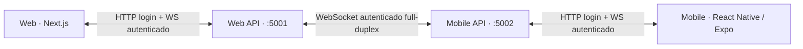

# ChatBridge

Chat em tempo real entre um site Next.js e um aplicativo React Native/Expo, desenvolvido para a [avaliação técnica](Avaliacao.MD). Cada cliente acessa sua própria API ASP.NET Core; as duas APIs trocam mensagens por um canal WebSocket autenticado e bidirecional, sem banco de dados.

O MVP oferece login independente, conversa com identificação do autor, validação de mensagens, reconexão, aviso de indisponibilidade, expiração de sessão e logout. O remetente acompanha o estado de envio e a confirmação do backend remoto. As telas e alguns nomes internos conservam o nome **TalkToMe**.

Implementação dos Gates 0–4 concluída, com evidências automatizadas de Web ↔ Android físico. O estado da CI e a origem dessa informação estão na [seção de integração contínua](#integração-contínua). As limitações de segurança e de entrega fazem parte do escopo documentado.

**Navegação:** [Arquitetura](#arquitetura) · [Tecnologias](#tecnologias) · [Configuração](#configuração-inicial) · [Execução](#execução) · [Demonstração](#demonstração-funcional) · [Testes](#testes-automatizados) · [CI](#integração-contínua) · [Limitações](#segurança-e-limitações) · [Documentação](#documentação-complementar)

## Arquitetura



- **Duas APIs independentes:** processos, configurações, contas e validação JWT separados. Cada frontend comunica-se exclusivamente com sua API; o Next.js não atua como proxy de chat.
- **Um canal entre serviços:** a Web API inicia a conexão com `/internal/ws` da Mobile API. Ambos enviam pelo mesmo canal full-duplex, autenticado por uma chave de serviço distinta dos tokens de usuário. Não há polling ou duas conexões espelhadas.
- **Validação no backend:** a API verifica credenciais, token e conteúdo, aplica `Trim()` e define autor, origem e horário. Campos de identidade enviados pelo cliente não substituem a identidade autenticada.
- **Responsabilidades separadas:** `AuthService`, `ChatService`, `ClientHub`, `MessageCache`, `SocketConnection` e `PeerTransport` separam autenticação, chat, sessões, deduplicação e transporte. `Program.cs` compõe endpoints e serviços com injeção de dependência. Contratos locais seguem uma especificação JSON única.
- **Memória apenas:** uma sala `general`, duas contas demo e deduplicação com retenção limitada. Não há banco, histórico persistente ou broker.

O evento `chat.ack` com `remote_received` confirma que **o backend remoto recebeu, validou e aceitou** a mensagem. Não confirma entrega ao aparelho nem leitura. O canal tem heartbeat e reconexão com backoff; mensagens não são reenviadas automaticamente. Detalhes em [arquitetura](docs/ARCHITECTURE.md) e [contrato v1](docs/MESSAGE_CONTRACT.md).

## Tecnologias

Versões conferidas nos manifests e lockfiles do repositório; não representam consulta às versões mais recentes dos fornecedores.

| Componente | Tecnologias e versões |
|---|---|
| APIs | ASP.NET Core / `net10.0`; SDK `10.0.404` em [global.json](global.json), com `latestPatch`; JwtBearer `10.0.15` |
| Web | Next.js `16.4.6`, React `19.3.1`, TypeScript `5.9.3` |
| Mobile | Expo `58.0.26`, React Native `0.88.1`, React `19.3.0`, TypeScript `6.0.3` |
| Testes | Playwright `1.65.1` com Microsoft Edge; Node test runner; `ws` `8.23.0`; checks .NET |
| Ambiente de referência | Node `24.x`, npm `11.x`, PowerShell; CI em `windows-2025` |

Os pacotes npm são reproduzidos por `npm ci`; as APIs têm lockfiles NuGet. Node `24.18.0` e `24.22.3` constam nas validações locais registradas, e a CI acompanha a major 24.

## Estrutura do repositório

```text
.github/workflows/ci.yml  Builds, testes e auditoria no GitHub Actions
apps/
  web/                   Frontend Next.js e testes Playwright
  mobile/                Aplicativo Expo, testes unitários e automação Android
services/
  web-api/               API exclusiva do navegador
  mobile-api/            API exclusiva do aplicativo
shared/contracts/        Referência à especificação; sem biblioteca C# compartilhada
tests/
  integration/           Integração HTTP/WS e regressões do harness
  transport/             Checks de concorrência, timeout e cancelamento .NET
scripts/                 Configuração local, execução das APIs e coletor de auditoria
docs/                    Arquitetura, decisões, contrato, plano de testes e evidências
```

## Pré-requisitos

- Git, SDK .NET compatível com `global.json` e Node 24 com npm. Não basta instalar somente o runtime .NET.
- PowerShell para os comandos abaixo, executados na raiz do clone salvo indicação contrária. Windows PowerShell 5.1 foi validado localmente; a CI usa PowerShell 7. Em outro sistema, utilize PowerShell 7 ou exporte as variáveis da API no shell correspondente antes de executar `dotnet run`.
- Android com depuração USB autorizada, cabo de dados, Android SDK Platform-Tools/ADB e Expo Go compatível com SDK 58. Não é necessário Expo global, conta EAS ou APK próprio para a demonstração.
- Microsoft Edge para Playwright e a automação Android. O comando de instalação está na seção de testes.
- Portas `3000`, `5001`, `5002` e `8081` disponíveis. A porta **8081 é do Metro**, que fornece o bundle ao Expo Go; a API usada pelo app é a **5002**.

O ambiente comprovado é Windows com Edge e Samsung SM-A055M/Android 15. Emulador, iOS e outros sistemas não têm validação registrada. A automação Android existente usa explicitamente o ADB em `%LOCALAPPDATA%/Android/Sdk/platform-tools/adb.exe`; outro caminho ou sistema exige adaptação do harness, não apenas uma variável `PATH`.

## Configuração inicial

### Dependências e builds

Na raiz de um clone do repositório:

```powershell
npm ci --prefix apps/web
npm ci --prefix apps/mobile
npm ci --prefix tests/integration

dotnet restore services/mobile-api/ChatBridge.Api.csproj --locked-mode
dotnet restore services/web-api/ChatBridge.Api.csproj --locked-mode
dotnet build services/mobile-api/ChatBridge.Api.csproj --no-restore --nologo
dotnet build services/web-api/ChatBridge.Api.csproj --no-restore --nologo
```

Mantenha os builds em **Debug**, padrão desses comandos: os harnesses carregam `bin/Debug/net10.0/ChatBridge.Api.dll`.

### Configurações e contas locais

```powershell
./scripts/Initialize-Development.ps1
```

O script cria `services/web-api/.env` e `services/mobile-api/.env`, ignorados pelo Git, com chaves JWT diferentes, chave interbackend comum e senhas aleatórias independentes. Ele recusa sobrescrita se qualquer configuração já existir; nesse caso, preserve os arquivos e confira os valores localmente.

| Cliente | Usuário | Onde consultar a senha local |
|---|---|---|
| Web | `web-demo` | `DemoUser__Password` em `services/web-api/.env` |
| Mobile | `mobile-demo` | `DemoUser__Password` em `services/mobile-api/.env` |

Não há senha fixa versionada. Não renomeie as contas isoladamente: o receptor interbackend valida as identidades demo previstas no contrato. Não compartilhe os `.env` ou copie seus valores para documentação, screenshots ou variáveis públicas dos frontends.

As URLs padrão já permitem a demonstração local. Para explicitá-las, crie as cópias abaixo somente se ainda não existirem:

```powershell
if (!(Test-Path apps/web/.env.local)) {
    Copy-Item apps/web/.env.example apps/web/.env.local
}
if (!(Test-Path apps/mobile/.env.local)) {
    Copy-Item apps/mobile/.env.example apps/mobile/.env.local
}
```

- Web: `NEXT_PUBLIC_API_URL=http://localhost:5001`.
- Mobile por USB/reverse: `EXPO_PUBLIC_API_URL=http://127.0.0.1:5002`.

Next.js e Expo carregam `.env.local`; **.NET não carrega dotenv automaticamente**. Use `Run-Api.ps1`, que carrega o `.env` no processo e restaura as variáveis ao terminar. Reinicie os frontends após mudar suas URLs; para o Web em produção local, refaça o build.

**Binding Mobile:** o exemplo usa `ASPNETCORE_URLS=http://0.0.0.0:5002`, escutando interfaces IPv4. Para uso exclusivamente local/USB, ajuste essa linha no `.env` local para `http://localhost:5002`. USB/reverse não restringe um binding em `0.0.0.0`. Não é necessário abrir firewall para a estratégia USB.

## Execução

Use quatro terminais separados, nesta ordem:

| Ordem | Diretório do terminal | Comando | Acesso |
|---|---|---|---|
| 1 — Mobile API | raiz | `./scripts/Run-Api.ps1 -Role mobile` | `http://localhost:5002` |
| 2 — Web API | raiz | `./scripts/Run-Api.ps1 -Role web` | `http://localhost:5001` |
| 3 — Web | raiz | `npm run dev --prefix apps/web` | `http://localhost:3000` |
| 4 — Mobile | raiz | `npm run android --prefix apps/mobile` | Expo Go, via Metro em `localhost:8081` |

Antes do quarto comando, prepare o USB conforme abaixo. Acesse o site por **localhost:3000**, pois a Web API valida esse Origin; `127.0.0.1:3000` é uma origem diferente. Para iniciar o Web com build de produção local, use `npm run build --prefix apps/web` seguido de `npm run start --prefix apps/web`, com a porta 3000 livre.

As APIs expõem `POST /auth/login`, `/ws/chat` autenticado e `GET /health`. Somente a Mobile API aceita `/internal/ws` com a credencial de serviço. Para conferir o canal:

```powershell
Invoke-RestMethod http://localhost:5001/health
Invoke-RestMethod http://localhost:5002/health
```

Espere `interbackend: connected` antes da conversa. O health check informa o estado do serviço/canal, não a entrega de mensagens.

### Android por USB

No Windows com SDK no caminho padrão:

```powershell
$adbPath = Join-Path $env:LOCALAPPDATA 'Android/Sdk/platform-tools/adb.exe'
& $adbPath devices
# Substitua SERIAL pelo identificador listado com estado device.
& $adbPath -s SERIAL reverse tcp:5002 tcp:5002
& $adbPath -s SERIAL reverse tcp:8081 tcp:8081
npm run android --prefix apps/mobile
```

Se o SDK estiver em outro diretório, ajuste `$adbPath` para a execução manual. `unauthorized` exige aceitar a autorização no aparelho; uma lista vazia exige conferir cabo de dados, driver e depuração USB. Se `adb` não estiver no PATH, use o caminho completo como acima.

O CLI inicia Metro e abre o projeto no Expo Go; na primeira execução pode solicitar a instalação da versão compatível. **O endereço 127.0.0.1 no aparelho alcança a API do computador graças ao reverse.** Refaça os redirecionamentos após reconectar o USB. Se houver vários dispositivos, selecione o Android correto no CLI.

Em um emulador Android padrão, `http://10.0.2.2:5002` é a alternativa para `EXPO_PUBLIC_API_URL` sem reverse da API. O Metro também precisa estar acessível: o script mantém `--localhost`, portanto preserve o reverse da porta 8081. Essa alternativa não foi validada em emulador neste projeto.

Encerre os quatro processos com `Ctrl+C`. Para remover somente os redirecionamentos desta demonstração:

```powershell
& $adbPath -s SERIAL reverse --remove tcp:5002
& $adbPath -s SERIAL reverse --remove tcp:8081
```

## Demonstração funcional

1. No site, tente uma senha inválida e observe o erro; depois entre com `web-demo` e sua senha local. No app, repita com `mobile-demo` e a senha da Mobile API.
2. Envie uma mensagem do Web. Confira o texto e a autoria Web no Android e o estado **Recebida pelo serviço remoto** no remetente.
3. Responda pelo Android. Confira a autoria Mobile no navegador e a confirmação no aplicativo.
4. Tente enviar texto vazio ou somente espaços: a interface bloqueia e o backend também rejeita. O limite é 2000 unidades UTF-16.
5. Pare a Mobile API com `Ctrl+C` e tente enviar pelo Web: deve aparecer indisponibilidade, sem falso sucesso. Reinicie a API, aguarde a reconexão e envie uma **nova** mensagem. Repita invertendo os serviços para verificar a falha no Mobile.
6. Use **Sair** em cada cliente: o socket e a sessão local são encerrados. Recarregar o navegador exige novo login.

ACK remoto não equivale a leitura ou entrega ao dispositivo. Até com o destinatário offline, o backend remoto pode aceitar e confirmar; não haverá recuperação posterior. Se o ACK se perder, o resultado é **incerto**, sem reenvio automático: o timeout entre APIs é de 5s, e os clientes também têm uma espera máxima de 12s pela resposta. As interfaces distinguem conexão com a própria API e disponibilidade do serviço remoto. Após três falhas consecutivas de handshake, use **Reconectar** quando oferecido. No Android, ir para segundo plano fecha o socket; o retorno reconecta enquanto o token for válido, sem garantia de recepção em background.

## Testes automatizados

Execute os harnesses **sequencialmente**, com APIs e Next manuais parados. Backend usa 5001/5002; Web e Android usam também 3000. Eles iniciam seus próprios processos com credenciais efêmeras, independentes dos `.env` locais. A regressão do harness também precisa da porta 5001 livre.

Depois da instalação e dos builds anteriores, configure destinos novos para preservar as evidências históricas. Os blocos seguintes assumem a mesma sessão PowerShell na raiz:

```powershell
$evidenceRoot = Join-Path (Get-Location) ('docs/evidence/local-' + (Get-Date -Format 'yyyyMMdd-HHmmss-fff'))

dotnet run --project tests/transport/TransportChecks.csproj
node --test tests/integration/lifecycle.test.mjs
$env:EVIDENCE_DIR = Join-Path $evidenceRoot 'backend'
node tests/integration/run.mjs
```

São quatro checks .NET, três regressões do harness e 18 grupos de integração. T04/T05 usam duas APIs reais; falhas de ACK/heartbeat usam um peer controlado, e os checks internos de transporte usam sockets simulados. O T17 inclui 20 rejeições por limite de clientes em cada API. O harness grava checkpoints; `RUNNING` indica resultado incompleto, não aprovação.

### Web — Playwright

```powershell
npm run typecheck --prefix apps/web
npm run lint --prefix apps/web
npm run build --prefix apps/web
Push-Location apps/web
npx --no-install playwright install msedge
Pop-Location
$env:EVIDENCE_DIR = Join-Path $evidenceRoot 'web'
npm test --prefix apps/web
```

A instalação do Edge pode solicitar permissão do sistema; se ele já estiver instalado, não é necessário reinstalá-lo. O Playwright usa `channel: msedge`, um worker, contextos isolados e Next em produção local. Os oito cenários W01–W08 cobrem login, fluxo bidirecional, validação, falhas, responsividade, expiração e ACK incerto. O peer Mobile desses testes é um cliente WebSocket de teste, não o aplicativo Android.

### Mobile — verificações sem aparelho

```powershell
npm run typecheck --prefix apps/mobile
npm test --prefix apps/mobile
Push-Location apps/mobile
npx --yes expo-doctor@1.21.8
Pop-Location
npm run export --prefix apps/mobile
```

Os seis testes exercitam o transporte TypeScript com sockets controlados. A exportação gera bundle Android/Hermes em `apps/mobile/dist`; **não gera APK**, não instala o aplicativo e não substitui teste físico.

### Android físico — execução local, fora da CI

Requer Windows, ADB no caminho padrão citado, Expo Go compatível, aparelho desbloqueado e reservado, Edge, dependências dos três projetos npm e builds das APIs e Web. Pare os serviços manuais nas portas 3000/5001/5002. Em outro terminal na raiz, mantenha somente o Metro deste projeto:

```powershell
$env:CI = '1'
npm run start --prefix apps/mobile
```

No terminal de testes, com `$evidenceRoot` já definido:

```powershell
# Se houver mais de um dispositivo, defina ANDROID_SERIAL com o serial desejado.
$env:EVIDENCE_DIR = Join-Path $evidenceRoot 'android'
npm run test:android --prefix apps/mobile
Remove-Item Env:EVIDENCE_DIR
```

O harness configura reverse, abre Expo Go, inicia APIs/Next com credenciais efêmeras e executa M01–M10 por ADB e Edge. Testa os dois sentidos, falhas, teclado, rolagem, segundo plano, expiração e logout, gravando relatórios e capturas. Não use outro Metro ou interaja com o aparelho durante o teste. Ao concluir, encerre Metro, remova `Env:CI` nesse terminal e os dois redirecionamentos USB. Se não executar o teste físico, remova `Env:EVIDENCE_DIR` após os demais testes.

Há [resultados físicos do Gate 4](docs/evidence/gate4/android/android-results.json) e [captura real da conversa](docs/evidence/gate4/android/chat-android.png). Automação de UI não equivale a avaliação humana de conforto ou acessibilidade. Consulte a [matriz completa](docs/TEST_PLAN.md) e o [histórico de execuções](docs/PROGRESS.md).

## Integração contínua

O [workflow CI](.github/workflows/ci.yml) executa em PRs destinados à `main`, pushes na `main` e acionamento manual (`workflow_dispatch`). São quatro jobs independentes em Windows Server 2025, com Node 24 e SDK conforme `global.json`:

| Job | Verificações |
|---|---|
| Backends | Restore locked, builds Debug, quatro checks .NET, três regressões do harness e integração com duas APIs reais |
| Web | `npm ci`, typecheck, lint, build, Edge e oito cenários Playwright |
| Mobile | `npm ci`, typecheck, seis testes, Expo Doctor 1.21.8 e exportação Android/Hermes |
| Auditoria informativa | Testes do coletor e quatro consultas `npm audit`: Web/Mobile, completas e `--omit=dev` |

**Estado desta revisão — 18/11/2026:** merge do [PR #6](https://github.com/LuizAmaro12/ChatBridge/pull/6) confirmado na `main` remota, commit `cdb2988`. Os quatro jobs foram aprovados na validação do PR conforme informado pelo responsável. A consulta pública ao Actions retornou 404 nesta revisão; não foi possível confirmar independentemente a execução mais recente após o merge. Consulte os checks do PR e [Actions → CI](https://github.com/LuizAmaro12/ChatBridge/actions/workflows/ci.yml), com acesso ao repositório, para o estado atualizado. Os relatórios em `docs/evidence/ci` são de validação **local**, não artifacts da execução hospedada.

Falhas de build/teste reprovam o job. A auditoria é informativa: alertas de vulnerabilidade geram avisos, mas não reprovam a coleta; erro de consulta, timeout ou JSON inválido a reprovam. **Um job verde não significa ausência de vulnerabilidades.**

Artifacts, retidos por sete dias: `ci-backends`, `ci-web`, `ci-mobile-export-metadata` e `ci-audit-informational`. O upload é tentado também após falhas; se o processo não produziu arquivos, pode não haver artifact. Logs dos passos ajudam a distinguir falha, cancelamento e teste não executado. Os relatórios usam o diretório temporário do runner, sem sobrescrever evidências históricas.

A CI usa credenciais de teste efêmeras, permissão `contents: read`, cache npm por lockfile e cancelamento de execução anterior do mesmo PR. Não exige secrets pessoais. **Não há deploy/CD, APK ou teste físico Android no runner.**

Para reproduzir apenas a coleta de auditoria local:

```powershell
node --test scripts/ci/audit.test.mjs
$env:AUDIT_OUTPUT_DIR = Join-Path $env:TEMP ('chatbridge-audit-' + (Get-Date -Format 'yyyyMMdd-HHmmss-fff'))
node scripts/ci/audit.mjs
Remove-Item Env:AUDIT_OUTPUT_DIR
```

## Segurança e limitações

- JWTs independentes, com validação de assinatura, emissor, público e expiração; sessão padrão de uma hora. Tokens permanecem em memória dos clientes. Logout não revoga um JWT já emitido; não há refresh token ou rate limit de login.
- Canal interbackend autenticado por chave própria e comparação em tempo constante. Origin Web é validado separadamente de CORS; Mobile nativo usa Origin vazio, mas continua exigindo JWT.
- Conteúdo exibido como texto, autoria definida pelo servidor, limite de 2000 unidades UTF-16 e de 16 KiB por mensagem WS. Clientes, filas e operações pendentes são limitados; deduplicação padrão de dez minutos/10.000 entradas, perdida no reinício.
- JWT no handshake WS via query string exige cuidado com logs e proxies. As APIs suprimem logs que poderiam registrar a query, e o harness verifica segredos nos logs coletados. Variáveis `NEXT_PUBLIC_*`/`EXPO_PUBLIC_*` são públicas e nunca devem conter segredos.
- HTTP/WS são usados para demonstração local. Uma implantação pública exigiria HTTPS/WSS e revisão adicional de segurança; não há aprovação de produção.
- Uma sala e duas contas demo, sem cadastro, histórico persistente, notificações, uploads ou sincronização entre sessões da mesma conta. Não há garantia de entrega offline, leitura, exatamente-uma-vez ou recepção em segundo plano.
- Não foram validados iOS, emulador, outros dispositivos/navegadores, TalkBack, carga prolongada, rede degradada real ou encerramento sob carga. As evidências existentes não comprovam esses cenários.

**Dependências:** a [análise do Gate 4](docs/evidence/gate4/security-analysis.md) preserva os alertas de picomatch/minimatch e seus limites de alcance. A [coleta local posterior da CI](docs/evidence/ci/results.json), de 18/11/2026 às 19:07 (America/Sao_Paulo), retornou Web sem alertas e Mobile com três moderados em ambos os modos. Nenhuma dependência foi atualizada entre essas consultas; a mudança de contagem não comprova uma correção do projeto. Não se apresenta nenhuma dessas consultas como auditoria atual permanente. No Expo, ferramentas de build também estão em `dependencies`, portanto `--omit=dev` não equivale a analisar apenas o bundle instalado. Consulte os artifacts mais recentes antes de avaliar os riscos.

## Documentação complementar

- [Requisitos e critérios da avaliação](Avaliacao.MD) e [guia de execução](AGENTS.md).
- [Arquitetura e responsabilidades](docs/ARCHITECTURE.md).
- [Contrato JSON, ACK, erros e limites](docs/MESSAGE_CONTRACT.md).
- [Decisões técnicas e trade-offs](docs/DECISIONS.md).
- [Plano de testes e cobertura](docs/TEST_PLAN.md).
- [Progresso e evidências dos Gates 0–4 e da CI](docs/PROGRESS.md).
- [Identidade visual Web/Mobile](docs/UI_UX.md).
- [Validação local inicial da CI](docs/evidence/ci/validation.json) e [regressão WebSocket com Node 24.22.3](docs/evidence/ci-websocket-fix/after-node24.22.3-stress.json).

Os documentos de progresso e decisões preservam registros históricos, inclusive estados anteriores de implementação e publicação. Considere a data e o escopo de cada evidência ao compará-la com o código atual.
