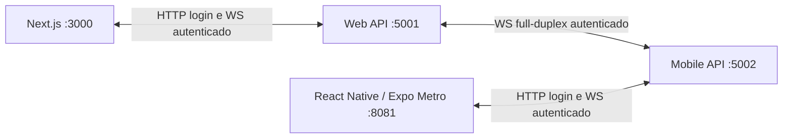

# Arquitetura — Gate 1

Web API inicia a única conexão persistente para `ws://localhost:5002/internal/ws`. Mobile API aceita um serviço autenticado por vez; outra conexão recebe HTTP 409 enquanto a atual estiver ativa. Ambos enviam no mesmo canal. Nenhum frontend conhece o endpoint do outro backend.

## Responsabilidades

| Componente | Responsabilidade |
|---|---|
| Clientes | Login, token em memória, conexão própria, lista/autoria, composição, estados e erros |
| Auth de cada API | Conta local, emissão e validação JWT, expiração |
| ChatService | Trim/limites, identidade autenticada, envelope e encaminhamento |
| ClientConnectionManager | Registro/remoção e publicação local; envio serializado por socket |
| InterbackendTransport | Handshake, conexão, ACK pendente, timeout, deduplicação e reconexão |
| DTOs e opções | Contrato explícito e configuração validada no startup |

Implementação: Program.cs compõe endpoints/DI; Auth/AuthService valida credenciais e emite JWT; Configuration/ChatOptions valida configuração; Chat/ChatService valida chat; ClientHub administra sessões e filas; MessageCache deduplica; Transport/SocketConnection serializa envios/limita mensagens; PeerTransport gerencia o canal. Não compartilhar regras de negócio entre APIs. DTOs locais em Contracts/Events.cs; `shared/contracts` aponta à especificação única. Logs estruturados com messageId e transições de conexão, sem senha, JWT, chave ou query string de autenticação.

## Autenticação

Cada API expõe `POST /auth/login` com `{ "username": "web-demo", "password": "valor-local" }` (mobile usa `mobile-demo`). HTTP 200: `{ "accessToken": "JWT", "expiresAt": "2026-11-17T23:00:00Z", "user": { "id": "web-demo", "name": "Usuário Web" } }`. HTTP 401: `{ "code": "invalid_credentials", "message": "Credenciais inválidas." }`; JSON/body inválido: 400. Limite de body 4 KiB; não diferenciar usuário inexistente de senha incorreta.

JWT HS256, chave aleatória mínima de 32 bytes distinta por API, issuer/audience próprios, expiração 60 minutos, validação de assinatura, algoritmo, emissor, público e validade, tolerância de relógio 30 segundos. Claims sub/name definidas pelo servidor. A API não aceita token da outra. Sem refresh: novo login após expirar. Senhas demo em configuração local, nenhuma credencial funcional no repositório.

Cliente abre `/ws/chat?access_token=...`: navegador não permite header Authorization customizado no construtor WebSocket. Usar o mesmo mecanismo no Expo reduz divergências. Validar antes do upgrade (401), restringir token por query à rota exata, suprimir query nos logs; manter token apenas em memória. Web API exige Origin autorizado; cliente nativo pode omitir Origin na Mobile API, que continua exigindo JWT. Revalidar expiração antes de processar mensagens e fechar socket no vencimento (1008). Logout fecha socket e apaga token; não revoga JWT já emitido.

Web API usa `Authorization: Bearer <chave-de-serviço>` no handshake interbackend. Mobile compara bytes de tamanho validado em tempo constante. Chave aleatória mínima de 32 bytes, diferente dos JWT; rejeição 401 antes do upgrade. Nenhum token de usuário identifica serviço. Configurações ausentes/inseguras devem falhar no startup.

## Fluxos simétricos

Web → Mobile: cliente envia `chat.send`; Web API valida e enriquece; envia `chat.message` no canal interno; Mobile API valida origem web, deduplica e aceita a mensagem, retornando ACK de recepção; Web API correlaciona e repassa ACK ao remetente. A distribuição aos clientes locais ocorre de forma independente, com falhas tratadas, sem aguardar clientes lentos nem bloquear a leitura interbackend. O ACK não depende da conclusão dessa distribuição.

Mobile → Web: mesmo fluxo invertido, usando a conexão que a Web API já iniciou. Recepção interbackend nunca reencaminha mensagem ao outro backend. Não criar duas conexões espelhadas. O remetente mantém sua mensagem local pendente e atualiza pelo ACK; não há eco para ele. Outras sessões da mesma conta de origem não recebem sincronização no MVP.

ACK significa recepção/aceitação pelo backend remoto; não leitura, nem confirmação pelo dispositivo. Sem destinatário conectado, ainda há ACK e nenhuma recuperação posterior. Interface informa permanentemente essa limitação.

## Falhas e ciclo de vida

Canal ausente: erro imediato correlacionado. ACK não recebido em 5s: resultado incerto, sem reenvio automático. Desconexão falha todas as pendências; cliente não deve mostrar sucesso. Reconectar somente o transporte, sem replay de mensagens.

Web API tenta conectar com timeout de 5s e backoff 1, 2, 4, 8, 16, 30 segundos, limitado a 30s com jitter de até 20% dentro do teto; reset após conexão estável por 30s. Heartbeat de aplicação a cada 10s; ausência de pong em 10s derruba o canal. Apenas uma tentativa ativa. Clientes podem reconectar com backoff equivalente enquanto token válido; expiração exige login.

Recepção deve continuar lendo ACKs sem aguardar o ACK do próprio envio. Um lock de envio por socket; no máximo 100 ACKs pendentes por API (erro busy além disso). Limitar envio individual a 2s e remover cliente lento/encerrado; falha de cliente não derruba o canal entre APIs. Shutdown cancela loops, timeouts e esperas, encerra sockets e remove registros em finally. Sem fila persistente.

Cada cliente tem fila de saída em memória de 100 eventos, consumida por um writer exclusivo. Publicação local usa TryWrite, sem espera; fila cheia cancela/remove cliente lento. Limite padrão de 100 clientes por API (excesso fecha WS com 1008) e 100 operações simultâneas por cliente. Filas são efêmeras, não representam broker ou entrega garantida. RequestAborted e ApplicationStopping cancelam os loops. Na expiração, CloseOutput 1008 permite ao leitor observar resposta do peer por até 2s antes de cancelar.

## Configuração efetiva

`.env.example` contém nomes; scripts PowerShell carregam `.env` apenas no processo. `Auth__TokenSeconds=3600` substitui o placeholder TokenMinutes do Gate 0. Heartbeat padrão 10s, ACK 5s, retenção 600s, cache 10000. Os testes reduzem heartbeat/retenção e limites em processos específicos, registrando essa diferença. Contas do protocolo são web-demo/mobile-demo; não renomeá-las isoladamente, pois o receptor valida a identidade demo esperada. `GET /health` informa vida e estado do canal; não é prova de entrega.
